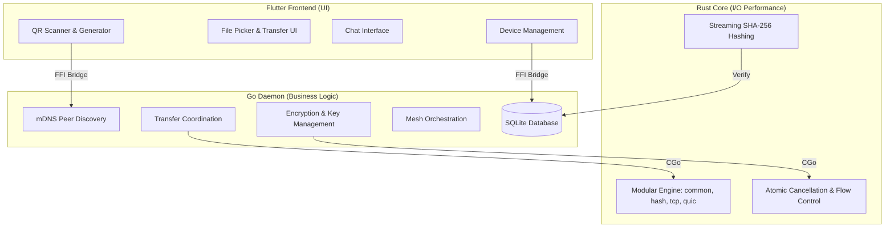

# 🌊 HydraShare

**Secure, Fast, Cross-Platform File Sharing**

HydraShare is a modern peer-to-peer file sharing application that enables seamless file transfers between devices on the same network. Built with security, speed, and user experience in mind.

## ✨ Features

### 🔐 Security

- **End-to-End Encryption**: AES-256-GCM encryption for all file transfers
- **QR Code Handshake**: Secure peer discovery and key exchange via QR codes
- **File Validation**: Real-time SHA-256 streaming hash verification for data integrity
- **Proximity-Based Auto-Disconnect**: Automatic disconnection when devices move apart
- **Atomic Cancellation**: Instant, thread-safe transfer cancellation via atomic signaling

### ⚡ Performance

- **Zero-Copy I/O**: Platform-optimized file transfers using Rust
- **Adaptive Throttling**: Intelligent bandwidth management based on network conditions
- **Resumable Transfers**: Persistent queue with automatic resumption from byte offsets
- **Multi-Hop Relay**: Mesh networking for extended range through relay nodes

### 🎯 User Experience

- **Cross-Platform**: Supports Android, Windows, Linux, and macOS
- **Modern UI**: Beautiful Flutter-based interface with dark mode support
- **Real-Time Chat**: Instant messaging between connected peers
- **Wake Lock**: Prevents screen dimming during active transfers
- **Transfer Notifications**: Real-time progress updates and completion alerts

### 🌐 Networking

- **mDNS Discovery**: Automatic peer discovery on local networks
- **Hybrid Transport**: Supports both QUIC/UDP (performance) and TCP (fallback)
- **Mesh Networking**: Guest-to-Guest direct connections via host relay
- **Multiple Transports**: Wi-Fi, Bluetooth, and USB RNDIS support

## 🏗️ Architecture

HydraShare uses a hybrid architecture combining the strengths of multiple technologies:



### Technology Stack

- **Frontend**: Flutter 3.10+ (Dart)
- **Backend**: Go 1.25+ (Logic, Networking, & SQLite)
- **I/O Core**: Modular Rust (Encrypted Streaming & QUIC)
- **Database**: SQLite (Message & Queue Persistence)
- **Discovery**: mDNS (Hashicorp mdns)
- **Encryption**: AES-256-GCM

## 📦 Project Structure

```
hydrashare/
├── daemon/                 # Go backend daemon
│   ├── cmd/
│   │   └── hydra_daemon/  # Main daemon entry point
│   ├── internal/          # Internal modular packages
│   │   ├── connectivity/  # Network & Throttling
│   │   ├── discovery/     # mDNS peer discovery
│   │   ├── mesh/          # Mesh & Orchestration
│   │   ├── storage/       # SQLite & Queueing
│   │   └── transfer/      # Session & Data Flow
│   ├── hydra_muscle/      # Modular Rust I/O core
│   │   ├── src/
│   │   │   ├── common.rs  # Shared types & errors
│   │   │   ├── hash.rs    # Hashing logic
│   │   │   ├── tcp.rs     # Encrypted TCP data plane
│   │   │   ├── quic.rs    # QUIC transport
│   │   │   └── lib.rs     # FFI Gateway
│   │   └── Cargo.toml
│   └── scripts/           # Build automation
│
├── frontend/              # Flutter mobile/desktop app
│   ├── lib/
│   │   ├── screens/       # UI screens
│   │   ├── services/      # Daemon & Notify services
│   │   └── widgets/       # UI components
│   └── android/           # Android JNI/FFI setup
│
└── README.md              # Project documentation
```

```

## 🚀 Getting Started

### Prerequisites

#### For Development

- **Go**: 1.25 or higher
- **Rust**: Latest stable (via rustup)
- **Flutter**: 3.10 or higher
- **C Compiler**:
  - Windows: MSVC (Visual Studio Build Tools)
  - Linux: GCC
  - macOS: Clang (Xcode Command Line Tools)

#### For Android Development

- **Android SDK**: API Level 21+ (Android 5.0+)
- **NDK**: r25 or higher
- **Java**: JDK 17+

### Installation

1. **Clone the repository**

   ```bash
   git clone https://github.com/yourusername/hydrashare.git
   cd hydrashare
   ```

1. **Build the Rust core**

   ```bash
   cd daemon/hydra_muscle
   cargo build --release
   cd ../..
   ```

2. **Build the Go daemon**

   **Windows:**

   ```powershell
   cd daemon
   .\scripts\build.ps1
   ```

   **Linux/macOS:**

   ```bash
   cd daemon
   ./scripts/build.sh
   ```

3. **Build the Flutter app**

   ```bash
   cd frontend
   flutter pub get
   flutter build apk  # For Android
   flutter build windows  # For Windows
   ```

### Running the Application

#### Desktop (Windows/Linux/macOS)

1. Start the daemon:

   ```bash
   ./daemon/bin/hydra_daemon
   ```

2. Run the Flutter app:

   ```bash
   cd frontend
   flutter run -d windows  # or linux/macos
   ```

#### Android

1. Connect your Android device or start an emulator

2. Build and run:

   ```bash
   cd frontend
   flutter run
   ```

The daemon will be automatically embedded and started via FFI.

## 📱 How to Use

### Host Mode (File Sender)

1. **Launch the app** and select **"Host"** role
2. **Generate QR Code** - The app will create a secure QR code containing:
   - Your device IP address
   - AES-256 encryption key
   - Device name
3. **Wait for guests** to scan your QR code
4. **Select files** to share and send to connected guests
5. **Monitor transfers** in real-time with progress indicators

### Guest Mode (File Receiver)

1. **Launch the app** and select **"Guest"** role
2. **Scan QR Code** from the host device
3. **Automatic connection** - Secure handshake and encryption setup
4. **Receive files** - Accept or reject incoming file offers
5. **Chat with host** and other guests in the mesh network

### Features Available in Both Modes

- **Real-time chat** with connected peers
- **File transfer management** with pause/resume
- **Connection status** monitoring
- **Transfer history** and message logs
- **Low power mode** toggle for battery saving

## 🧪 Testing

### Unit Tests

```bash
# Test Go daemon
cd daemon
go test ./...

# Test Rust core
cd hydra_muscle
cargo test
```

### Integration Tests

```bash
# Run automated transfer test
cd daemon/scripts
./test_receive.ps1  # Start receiver
./test_trigger.ps1  # Trigger transfer
```

### Manual Testing

1. **Two-Device Test**: Run host on one device, guest on another
2. **Mesh Test**: Connect multiple guests through a single host
3. **Resumption Test**: Interrupt and resume a large file transfer
4. **Encryption Test**: Verify files are encrypted in transit (packet capture)

## 🔧 Configuration

### Daemon Ports

- **5050**: Flutter client connection (TCP)
- **5051**: File transfer port (TCP)
- **5052**: Secure handshake listener (TCP)
- **5353**: mDNS discovery (UDP)

### Security Settings

- **Encryption**: AES-256-CBC (hardcoded, cannot be disabled)
- **Hash Algorithm**: SHA-256 for file verification
- **Max File Size**: 2GB (configurable in code)
- **Key Rotation**: Per-session (new key for each host session)

### Performance Tuning

Edit `daemon/internal/transfer/manager.go`:

- `BufferSize`: Adjust transfer buffer (default: 64KB)
- `ChunkSize`: Modify progress update frequency
- `MaxConcurrentTransfers`: Limit simultaneous transfers

## 🛠️ Development

### Building for Android

```bash
cd daemon
# Build for Android ARM64
GOOS=android GOARCH=arm64 CGO_ENABLED=1 \
  CC=$ANDROID_NDK_HOME/toolchains/llvm/prebuilt/linux-x86_64/bin/aarch64-linux-android21-clang \
  go build -buildmode=c-shared -o ../frontend/android/app/src/main/jniLibs/arm64-v8a/libhydra_daemon.so \
  ./cmd/hydra_daemon
```

### Code Style

- **Go**: Follow standard Go conventions (`gofmt`, `golint`)
- **Dart**: Use `flutter format` and `dart analyze`
- **Rust**: Use `cargo fmt` and `cargo clippy`

### Contributing

1. Fork the repository
2. Create a feature branch (`git checkout -b feature/amazing-feature`)
3. Commit your changes (`git commit -m 'Add amazing feature'`)
4. Push to the branch (`git push origin feature/amazing-feature`)
5. Open a Pull Request

## 📄 License

This project is licensed under the MIT License - see the LICENSE file for details.

## 🙏 Acknowledgments

- **Hashicorp mDNS**: For reliable peer discovery
- **Flutter Team**: For the amazing cross-platform framework
- **Go Community**: For excellent networking libraries
- **Rust Community**: For zero-cost abstractions and safety

## 🐛 Known Issues

- **Android 14+**: SELinux restrictions may affect network interface enumeration
- **Windows Firewall**: May require manual permission for daemon ports
- **Large Files**: Transfers >2GB require code modifications

## 🗺️ Roadmap

- [ ] Bluetooth transport support
- [ ] USB direct transfer
- [ ] Cloud relay for internet transfers
- [ ] End-to-end encrypted cloud backup
- [ ] Multi-language support
- [ ] iOS support
- [ ] Web interface

## 📞 Support

For issues, questions, or contributions:

- **Issues**: [GitHub Issues](https://github.com/yourusername/hydrashare/issues)
- **Discussions**: [GitHub Discussions](https://github.com/yourusername/hydrashare/discussions)

---

**Made with ❤️ by the HydraShare Team**
