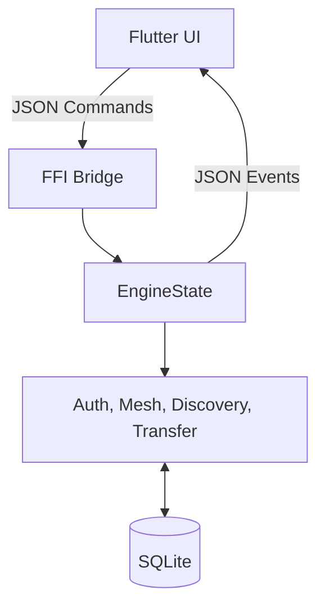

# 🌊 HydraShare

## Secure, Fast, Cross-Platform File Sharing

HydraShare is a modern peer-to-peer file sharing application that enables seamless file transfers between devices on the same network. Built with security, speed, and user experience in mind.

## ✨ Features

### 🔐 Security

- **End-to-End Encryption**: AES-256-GCM encryption for all file transfers via Rust `ring` backend
- **QR Code Handshake**: Secure peer discovery and key exchange via QR codes
- **PIN-Based Pairing**: Secure PBKDF2-HMAC authenticated pairing mechanism
- **File Validation**: Real-time SHA-256 streaming hash verification for data integrity
- **Atomic Cancellation**: Instant, thread-safe transfer cancellation via Rust atomic signaling

### ⚡ Performance

- **Pure Rust Engine**: High-performance, memory-safe data plane and control plane
- **QUIC Transport**: Low-latency, encrypted streams using the `quinn` implementation
- **Zero-Copy I/O**: Platform-optimized file transfers
- **Adaptive Throttling**: Intelligent bandwidth management based on network conditions
- **Resumable Transfers**: Persistent queue with automatic resumption from byte offsets

### 🎯 User Experience

- **Cross-Platform**: Supports Android, Windows, Linux, and macOS
- **Modern UI**: Beautiful Flutter-based interface with dark mode support
- **Real-Time Chat**: Instant messaging between connected peers
- **Transfer Notifications**: Real-time progress updates and completion alerts

### 🌐 Networking

- **mDNS Discovery**: Automatic peer discovery on local networks
- **QUIC-Only Protocol**: Single, unified protocol for handshakes, chat, and files
- **IPv6 Ready**: Full dual-stack support for modern network environments
- **Code Quality**: Strict `cargo clippy` and `flutter analyze` compliance across the entire codebase

## 🏗️ Architecture

HydraShare uses a streamlined architecture focusing on performance and safety:



### Technology Stack

- **Frontend**: Flutter 3.10+ (Dart)
- **Backend**: Pure Rust (Networking, Logic, & Persistence)
- **Database**: SQLite (via `rusqlite` with WAL)
- **Discovery**: mDNS (`mdns-sd`)
- **Encryption**: AES-256-GCM (`ring`)
- **Transport**: QUIC (`quinn`)

## 📦 Project Structure

```text
hydrashare/
├── daemon/                 # Rust backend engine
│   ├── hydra_muscle/      # Main logic crate
│   │   ├── src/
│   │   │   ├── auth/      # PIN & Session security
│   │   │   ├── core/      # Engine state & Lifecycle
│   │   │   ├── db/        # SQLite persistence
│   │   │   ├── mesh/      # P2P Orchestration
│   │   │   ├── quic/      # High-speed transport
│   │   │   └── ffi/       # Flutter bridge
│   │   └── Cargo.toml
│   └── bin/               # Compiled artifacts
│
├── frontend/              # Flutter mobile/desktop app
│   └── lib/
│       ├── services/      # Rust FFI bridge services
│       └── screens/       # UI implementations
│
└── scripts/               # Unified build automation
```

## 🚀 Getting Started

### Prerequisites

#### For Development

- **Rust**: Latest stable (via rustup)
- **Flutter**: 3.10 or higher
- **Android SDK**: API Level 21+ (Android 5.0+)
- **NDK**: r25 or higher
- **C Compiler**:
  - Windows: MSVC (Visual Studio Build Tools) or GCC (Strawberry)
  - Linux: GCC
  - macOS: Clang (Xcode Command Line Tools)

### Installation

1. **Clone the repository**

   ```bash
   git clone https://github.com/yourusername/hydrashare.git
   cd hydrashare
   ```

2. **Build the Engine**

   Use the unified build scripts provided in the `scripts/` directory:

   **Windows (PowerShell):**

   ```powershell
   .\scripts\build_windows.ps1
   ```

   **Android:**

   ```powershell
   .\scripts\build_android.ps1
   ```

3. **Build the Flutter App**

   ```bash
   cd frontend
   flutter pub get
   flutter build apk      # For Android
   flutter build windows  # For Windows
   ```

### Running the Application

#### Desktop (Windows)

1. Run the build script to ensure all artifacts are in `daemon/bin`.
2. Run the Flutter app:

   ```bash
   cd frontend
   flutter run -d windows
   ```

#### Android

1. Connect your Android device.
2. Build and run:

   ```bash
   cd frontend
   flutter run
   ```

## 📱 How to Use

1. **Permission**: Grant storage and network permissions.
2. **Pairing**: Use **Generate Credentials** on one device and enter the PIN on the other, or use the QR code.
3. **Transfer**: Select files and choose the destination peer.
4. **Chat**: Message peers directly during an active session.

## 🧪 Testing

### Unit Tests

```bash
# Test Rust core
cd daemon/hydra_muscle
cargo test
```

### Integration Tests

Integration testing is handled through the FFI layer. Ensure the daemon builds successfully, then run the Flutter integration tests:

```bash
cd frontend
flutter test integration_test/app_test.dart
```

### Automated Transfer Monitoring

```bash
# Run automated transfer test
cd daemon/scripts
./test_receive.ps1  # Start receiver
./test_trigger.ps1  # Trigger transfer
```

### Manual Testing

1. **Two-Device Test**: Run host on one device, guest on another
2. **Mesh Test**: Connect multiple guests through a single host
3. **Resumption Test**: Interrupt and resume a large file transfer
4. **Encryption Test**: Verify files are encrypted in transit (packet capture)

## 🔧 Configuration

### Daemon Ports

- **5051**: Peer Discovery (mDNS)
- **5053**: Mesh signaling and incoming transfers (QUIC)

### Device Security Configuration

- **Encryption**: AES-256-GCM (Permanent)
- **Hash Algorithm**: SHA-256 for file verification
- **Pairing**: PBKDF2-HMAC-SHA256 (100k iterations)
- **Session Keys**: Unique Ed25519 identity per device

## 📄 License

This project is licensed under the MIT License - see the LICENSE file for details.

## 🙏 Acknowledgments

- **Quinn**: For the incredible QUIC implementation in Rust.
- **Flutter Team**: For the beautiful cross-platform UI.
- **Rusqlite**: For high-performance SQLite bindings.

---

### Made with ❤️ by the HydraShare Team
